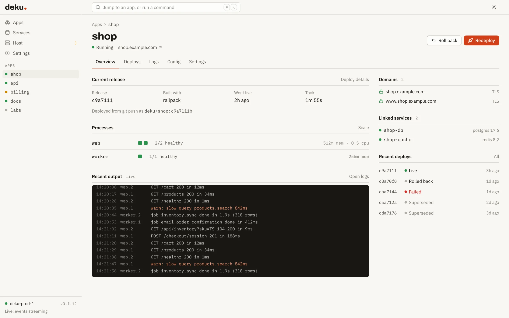

# Deku

<p><sub>Linux amd64 release artifacts: <code>deku</code> 11.4 MB, <code>dekud</code> 20.5 MB, dashboard bundle 1.3 MB</sub></p>

<p align="center">
  <picture>
    <source media="(prefers-color-scheme: dark)" srcset="docs/public/images/dashboard-app-dark.webp" />
    
  </picture>
</p>

Deku turns a Linux server into your own hosting platform. Deploy with one command and get HTTPS, databases, backups and rollbacks, without paying per app.

## Why Deku

- **Deploy the way you already work.** Send a project folder, a Docker image, or `git push`. Deku builds it with your Dockerfile, or works out how to build it when there is none, then starts it and serves it on your domain.
- **A broken deploy never reaches your users.** Your release command runs migrations first, and every new replica must pass its health check before it gets traffic. If any step fails, the current version keeps serving.
- **Undo a bad release with one command.** Every deploy is kept, and `deku deploy rollback` puts the previous version back.
- **HTTPS without the busywork.** Add a domain and point it at your server: Deku checks that it reaches the server, gets a Let's Encrypt certificate for it, and keeps it renewed. With a Cloudflare token, one wildcard certificate also covers every staging and preview address. Redirects, maintenance pages, and password or forward auth are settings, not config files.
- **Databases in one command.** Run Postgres, MySQL, MariaDB, Redis or MongoDB next to your app. Linking one gives the app its connection URL.
- **Backups you do not have to remember.** Schedule encrypted backups to any S3-compatible storage, and restore one when you need it.
- **Room to grow.** Scale each process type, set memory and CPU limits, run scheduled jobs, give staging and previews their own config, and offload builds to another machine.
- **Secure by default.** The dashboard listens on the server only, databases publish no port, apps are reachable only through the proxy, and config values are encrypted at rest.

## What You Get

- **A CLI and a daemon**: `dekud` runs the platform and `deku` drives it on the server. Both are Rust binaries.
- **Docker** runs your apps and services; **Angie** routes traffic and requests and renews certificates.
- **A dashboard** for apps, deploys, logs, services, routing, backups and host checks, served by the daemon itself.
- **An HTTP API** with an OpenAPI 3.1 reference at `/api/docs`, and app-scoped deploy tokens for CI.
- **Lifecycle hooks** that post build, deploy and app events to an HTTP endpoint and can gate a deploy.
- **Diagnostics**: `deku doctor`, searchable build and runtime logs, alerts, and a Prometheus metrics endpoint.
- **Runtime access**: `deku run` for one-off commands in a fresh container, `deku exec` to inspect a running one.
- **Starter templates** in [`templates/`](templates/) for common frameworks.

## Quick Start

Requirements:

- Linux server with `apt-get` available
- Ubuntu 22.04+ or Debian 11+
- Docker Engine 24+ and the `docker` CLI on `PATH`
- 512 MB RAM minimum
- Root access

Install on the server:

```bash
curl -fsSL https://get-deku.vercel.app/install.sh | sudo bash
```

After install:

```bash
deku dashboard
deku apps create my-app
deku deploy run my-app --path /absolute/path/to/app
```

Useful follow-up commands:

```bash
deku apps info my-app
deku deploy list my-app
deku logs my-app -n 100
deku ps list my-app
deku checks run my-app
deku checks routing my-app
deku doctor
```

New installs bind Deku's optional SSH deploy server to port `2222`, so it does not collide with a host `sshd` on port `22`. CLI and API deploys do not use the SSH listener.

## Dashboard

The dashboard is served by `dekud` itself, and it links to the interactive API reference.

```bash
deku dashboard
```

That prints the server-reachable URL, the loopback URL for on-host access, the config path, the token status, SSH tunnel and firewall guidance for remote access, and the command to mint a replacement token. The initial token is shown once during `deku setup`.

The dashboard and the authenticated HTTP API listen on TCP port `2810`, on loopback only for new installs. If your browser is on another machine, use the printed SSH tunnel command.

## Managed Services

Deku includes first-party workflows for Postgres, MySQL, MariaDB, Redis, and MongoDB. You can create, link, inspect, back up, and tail each one from the CLI or the dashboard.

Every service type supports backups through the configured object store:

- On demand, with `deku <type> backup <service>`, for example `deku postgres backup shop-db`
- On a schedule, with retention applied automatically: `deku backup schedule <service> --interval-hours 24 --keep 7`

Run `deku objectstore test` first. Backups fail without a working object store.

## Deploy Model

- Image deploys: `deku deploy run <app> --image <ref>`
- Source deploys: `deku deploy run <app> --path <dir>`
- SSH `git push` deploys: a supported secondary path
- Remote builds: an operator can offload builds to a separate host, and run `deku deploy run --build-host local` to override it

Starter templates live under [`templates/`](templates/) and are adapted for Deku's `dockerfile` and `railpack` builders.

Put migrations in a `release:` entry in the image's Procfile. It runs on every deploy, and a failure fails the deploy, so a broken migration never reaches the running app.

Rollout behavior is controlled by `deku.toml`, and Deku applies these values during the deploy rather than storing them as metadata:

```toml
[deploy]
healthcheck = "/health"
port = 3000
wait = 5
timeout = 30
attempts = 5
retire = 60
```

## Documentation

The documentation is published at <https://get-deku.vercel.app/>:

- [Installation and uninstall](https://get-deku.vercel.app/installation/)
- [Production checklist](https://get-deku.vercel.app/production/) for firewall, dashboard access, keys, and upgrades
- [Get started](https://get-deku.vercel.app/get-started/) with the first app and deploy
- [Traffic control](https://get-deku.vercel.app/traffic-control/) for maintenance mode and redirects
- [Deploy tokens](https://get-deku.vercel.app/deploy-tokens/) for deploying from CI without the dashboard token
- [Lifecycle hooks](https://get-deku.vercel.app/hooks/) for CI gates and deploy notifications
- [Runtime access](https://get-deku.vercel.app/runtime-access/) for `deku run` and `deku exec`
- [Resource limits](https://get-deku.vercel.app/resource-limits/) for memory and CPU caps
- [Backups](https://get-deku.vercel.app/backups/) for on-demand and scheduled datastore backups
- [Diagnostics](https://get-deku.vercel.app/diagnostics/) for host checks and log streaming
- [App authentication](https://get-deku.vercel.app/app-authentication/) for basic and forward auth
- [Build server](https://get-deku.vercel.app/build-server/) for offloaded builds
- [CLI reference](https://get-deku.vercel.app/reference/cli-reference/), [API reference](https://get-deku.vercel.app/reference/api-reference/), and [`deku.toml`](https://get-deku.vercel.app/reference/deku-toml/)
- [AGENTS.md](https://get-deku.vercel.app/agents/) for coding-agent workflows

## Repository Layout

- `crates/deku`: CLI
- `crates/dekud`: daemon and HTTP API
- `crates/deku-core`: shared types, auth utilities and file locations
- `dashboard/`: the shipped Astro + React dashboard
- `dashboard-next/`: the replacement dashboard (Vite, React, TanStack Router), running on mock data until it is wired to the API
- `docs/`: Starlight documentation site
- `scripts/`: installer, release packaging, and smoke tests
- `templates/`: local starter app catalog for common framework deploys

## Development

Rust 1.94 or newer is required. The floor is declared once as `rust-version` in the workspace manifest and inherited by every member crate. CI builds with Rust 1.98.1, checks the 1.94 floor separately, and audits dependencies with `cargo audit`. Set `DEKU_DOCKER_IT=1` to also run the tests that start real containers.

Common verification commands:

```bash
cargo fmt --all -- --check
cargo clippy --workspace --all-targets --all-features -- -D warnings
cargo test --all
```

Full local CI gate:

```bash
./scripts/ci-local.sh
```

Frontend and docs:

```bash
cd dashboard && bun install --frozen-lockfile
cd dashboard && bun run check
cd dashboard && bun run lint
cd dashboard && bun run build
cd docs && bun install --frozen-lockfile
cd docs && bun run check
cd docs && bun run build
```

The dashboard build output lives in `dashboard/dist`. Packaged installs consume that output through the release `deku-dashboard.tar.gz` artifact rather than embedding a compiled dashboard snapshot into `dekud`.

## License

MIT
